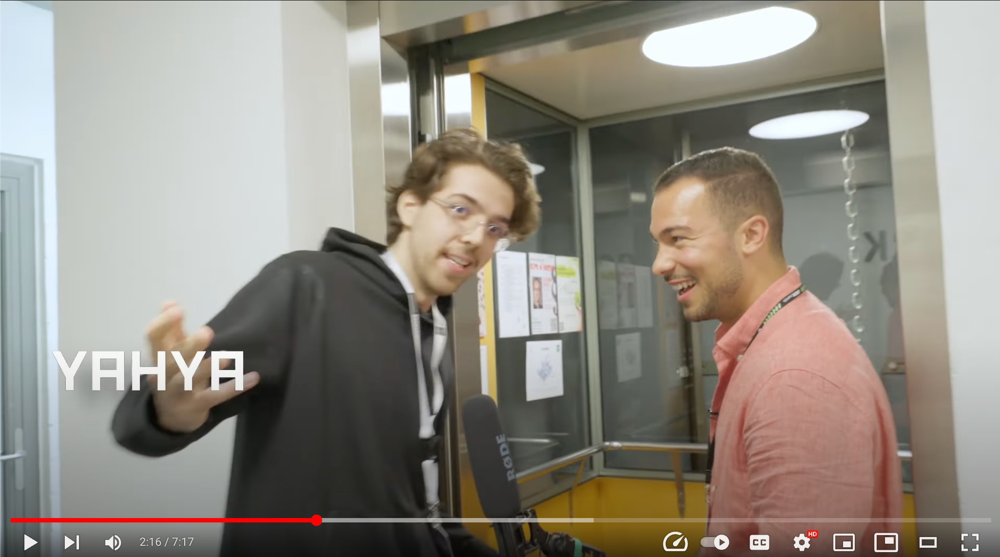
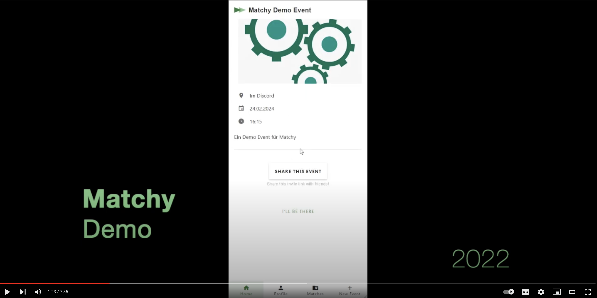

  

Matchy makes in-person speed dating paperless. Participants mark who they’d like to see again. Hosts can time rounds and send mutual matches without sorting cards by hand.

The project is paused. Thanks to FsWInf at TU Wien for helping us test Matchy at events, and to everyone who shared feedback.

Watch the HackZurich 2022 pitch and the app demo below. You can also watch [a speed-dating event](https://www.youtube.com/watch?v=p-3cmlPnx0s&t=9s) or browse the [UI mockups](/docs/figma%20mockups/V3/matchy%20V3.pdf).

  

  

